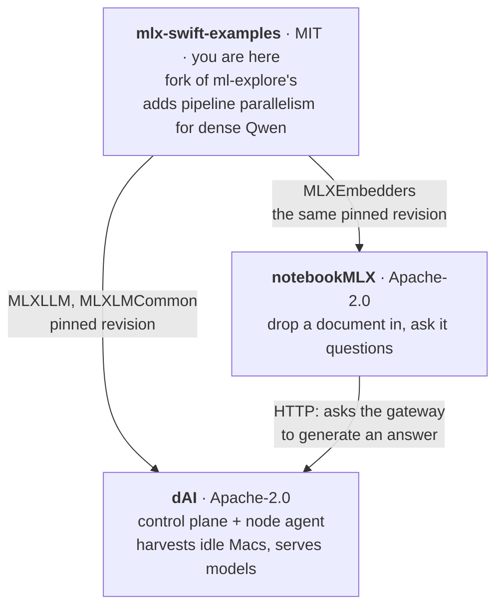

# This is a fork

Upstream is **[ml-explore/mlx-swift-examples](https://github.com/ml-explore/mlx-swift-examples)**,
MIT © 2024 ml-explore, and this fork remains MIT. Branched at `9bff95c`
(mlx-swift 0.29.1). Nothing upstream has been relicensed and no copyright notice
removed - every upstream commit here is byte-identical to upstream's, same shas,
same authors.

The branch that matters is **`dai-pipeline`**.

## Why it exists

Upstream has no pipeline parallelism for Qwen. Python `mlx-lm` has it and applies
it only to certain mixture-of-experts architectures. And `mlx-swift` excludes
distributed support deliberately - its `Package.swift` leaves out `ring.cpp`,
`mpi.cpp` and `nccl.cpp` and compiles the `no_ring.cpp` stub instead.

So a dense model too large for any single machine cannot be served at all. That
is the gap this fills: divide the layers, pass one hidden state per token between
the machines holding each slice.

It is a fork rather than a wrapper because the change cannot be made from
outside. The layer loop, the weight loader and the quantisation pass all have to
agree about which layers a machine owns, and none of them are extension points.

## What differs from upstream

Four files. The first three are the split, marked `dAI:` at each change.

| File | Change |
|---|---|
| `Libraries/MLXLLM/Pipeline.swift` | **New.** `PipelineSplit`, the `PipelineTransport` seam, `Pipelineable`, and `PipelineFault`. |
| `Libraries/MLXLLM/Models/Qwen2.swift` | Takes the hidden state from the machine holding the earlier layers, and hands its own on. |
| `Libraries/MLXLMCommon/Load.swift` | `loadWeights(..., keepingLayers:)` drops the layers this machine does not own and renumbers the rest. |
| `Libraries/Embedders/EmbeddingModel.swift` | `EmbeddingModelOutput.hiddenStates` and `pooledOutput` made public, so pooling can happen outside the library. |

**The transport is a protocol the caller supplies.** This library learns nothing
about certificates, fleets or sockets, and the code that owns those does not have
to fork a model library to change how bytes move. That seam is deliberate, and it
is what would make this contributable upstream.

## Who uses it

- **[dAI](https://github.com/djsincla/dAI)** - distributed AI on harvested Apple
  Silicon. Uses `MLXLLM` and `MLXLMCommon`, and the split is why this fork exists.
- **[notebookMLX](https://github.com/djsincla/notebookMLX)** - a document app.
  Uses `MLXEmbedders`.

Both pin **the same exact revision**, and must: two copies at different revisions
could pool or normalise differently, and an index built by one would be silently
incomparable with a query from the other. Each has a `ForkPinTests` binding its
resolved revision to the one its `NOTICE` names.

## Keeping up with upstream

A fork rots quietly. This one was **eight months and 27 commits behind** before
anyone counted, and three of the four files it changes had moved upstream in the
meantime. `9bff95c` reads as recent because it is a release tag; it is from
October 2025.

`.github/workflows/upstream-watch.yml` runs weekly and opens an issue **only**
when upstream touches one of the four files above - the set that will conflict.
"Upstream moved" would fire every week and be ignored. If this repository is a
real GitHub fork, the repository page also shows how far behind it is, which a
standalone repository does not.

### Rebasing

    git remote add upstream https://github.com/ml-explore/mlx-swift-examples.git
    git fetch upstream
    git rebase upstream/main dai-pipeline
    # conflicts land in the files marked `dAI:` - keep both sides
    xcodebuild build -scheme dai-agent -destination 'platform=OS X'

**Then follow the shas.** A rebase rewrites this fork's commits, so the revision
every consumer pins changes. Both must be updated together:

| Where | What |
|---|---|
| `dAI` | `agent/Package.swift`, `NOTICE`, `THIRD-PARTY-NOTICES.md` |
| `notebookMLX` | `Package.swift`, `NOTICE` |

`ForkPinTests` in each repository binds the resolved revision to the one its
`NOTICE` names and fails until they agree, so a half-finished bump is caught in
CI rather than discovered as an index that silently stops matching queries.

Do not skip the build. `swift build` cannot compile MLX's Metal shaders, so a
rebase that broke the split would still pass it.

## If you are upstream

The pipeline work is offered, not hoarded. The seam above was designed so it
could land without dragging fleet concerns into the library. This file and the
README banner are a separate commit at the tip of `dai-pipeline` precisely so a
pull request can be opened from the code commits without them.
